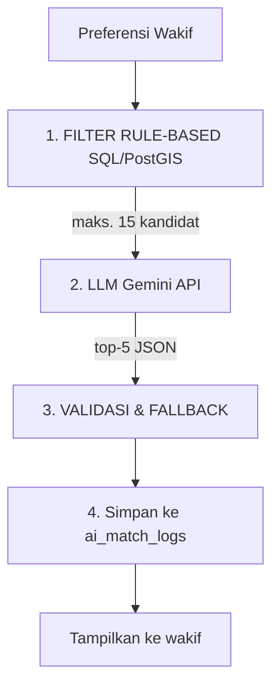

# Atsama Waqf
Platform Wakaf Hijau Berbasis Dampak (Outcome-Verified Waqf Financing)

Atsama Waqf (dari kata atsar = jejak, nama' = tumbuh) adalah platform digital yang mengubah wakaf hijau dari sekadar "donasi program" menjadi instrumen pembiayaan yang berorientasi pada jejak dampak yang dapat diverifikasi. Repositori ini adalah purwarupa fungsional (MVP) untuk mendukung penelitian dan naskah jurnal bertema Transformation of Financial Institutions Towards a Sustainable Economic System.

Prinsip utama (non-custodial): Atsama Waqf hanya berfungsi sebagai penghubung. Platform tidak menerima, menampung, atau menyalurkan dana wakaf. Wakif mentransfer langsung ke rekening Nazhir.

Keberlanjutan bisnis: Biaya layanan (service fee) untuk platform Atsama ditarik melalui skema langganan B2B atau tagihan terpisah ke Nazhir/Mitra, BUKAN memotong dana wakaf masyarakat.

## Latar Belakang Masalah
Krisis ekologis: Menurut data Auriga Nusantara, deforestasi Indonesia tahun 2025 mencapai 433.751 ha, naik 66% dari tahun 2024 (261.575 ha).
Kesenjangan potensi: Potensi wakaf nasional diperkirakan Rp 400 triliun. Potensi wakaf hijau diperkirakan mencapai Rp 180 triliun per tahun, tetapi implementasinya masih sangat terbatas.
Masalah kepercayaan: Wakif sulit menemukan proyek yang sesuai kepedulian spesifiknya, dan sulit melacak serta memverifikasi dampak nyata dari dana yang disalurkan.

## Konsep: Outcome-Verified Waqf Financing

Wakif memulai dari preferensi dampaknya sendiri, bukan dari katalog program lembaga. Setiap klaim dampak diberi label tingkat verifikasi, sehingga wakif dapat membedakan klaim yang baru dilaporkan dari yang sudah divalidasi pihak independen.

### Aktor & Peran
| Peran (user_role) | Tanggung jawab |
| :--- | :--- |
| **wakif** | Mengisi preferensi dampak, menerima rekomendasi, berniat berwakaf, mengunggah bukti transfer, memantau Social Impact Portfolio. |
| **nazhir** | Pemilik rekening penerima dana. Mengonfirmasi/menolak donasi, mencatat rencana anggaran (budgets) dan realisasi dana (fund_usages). |
| **mitra_pelaksana** | Menjalankan proyek lapangan dan melaporkan capaian indikator beserta bukti (foto/dokumen). |
| **verifikator** | Pihak independen yang memvalidasi laporan dampak di lapangan. |
| **admin** | Tim Atsama sebagai kurator: menyetujui akun institusi dan proyek, serta melakukan verifikasi internal laporan. |

*Akun nazhir, mitra_pelaksana, dan verifikator berstatus pending sampai disetujui Admin.*

## Alur Sistem

### 1. Status Donasi (transfer langsung ke Nazhir)
```
diniatkan ──► menunggu_verifikasi ──► dikonfirmasi_nazhir
                      │
                      └──────────────► ditolak
```

| Status | Terjadi saat | Aktor | Masuk Social Impact Portfolio? |
| :--- | :--- | :--- | :--- |
| **diniatkan** | Wakif menyatakan niat; sistem menerbitkan instruksi transfer (rekening Nazhir + kode referensi). | Wakif | ❌ |
| **menunggu_verifikasi** | Wakif mengunggah bukti transfer. | Wakif | ❌ |
| **dikonfirmasi_nazhir** | Nazhir mencocokkan dana masuk di rekeningnya. | Nazhir | ✅ Satu-satunya yang dihitung |
| **ditolak** | Nazhir tidak menemukan dana atau bukti tidak valid (alasan wajib diisi). | Nazhir | ❌ |

### 2. Verifikasi Laporan Dampak (3 Level Label)
| Level (verification_level) | Makna | Dilakukan oleh |
| :--- | :--- | :--- |
| **dilaporkan_mitra** | Klaim awal dari Mitra, belum diperiksa. | Mitra Pelaksana |
| **diverifikasi_internal** | Kelengkapan dan kewajaran data dikurasi Atsama. | Admin |
| **divalidasi_independen** | Capaian diperiksa langsung/independen di lapangan. | Verifikator |

Level naik berurutan. `divalidasi_independen` hanya bisa diberikan setelah `diverifikasi_internal` disetujui. Jika Mitra mengubah nilai laporan setelah diverifikasi, level kembali ke `dilaporkan_mitra`.

## Fitur MVP
- **Impact Matching (AI Hibrida)**: rekomendasi proyek lintas-Nazhir sesuai preferensi wakif.
- **Impact Tracking & Verification (dasbor 2 tingkat)**:
  - **Financial Tracking**: rencana anggaran (budgets) vs realisasi (fund_usages) vs dana terkonfirmasi.
  - **Impact Tracking**: capaian indikator (pohon ditanam, ton sampah dipilah, kWh energi terbarukan, dst.) dengan label 3 level verifikasi dan bukti terlampir.
- **Social Impact Portfolio**: akumulasi jejak kontribusi wakif lintas-proyek dan lintas-Nazhir. Hanya menghitung donasi `dikonfirmasi_nazhir` dan dampak yang terkait dengannya.
- **Green Project Marketplace**: etalase proyek terkurasi, baik internal (inisiatif Atsama) maupun eksternal (proyek lembaga lain yang ditautkan via `external_url`).

### Kategori Proyek (Enum MVP)
Konservasi & Kehutanan · Pengelolaan Sampah · Energi Berkelanjutan · Pemberdayaan Masyarakat

## Logika AI Matching (Hibrida)
AI tidak mencari dari nol. Aturan menyaring, LLM hanya meranking dan menjelaskan.



Aturan keras untuk LLM:
1. Hanya boleh memakai data kandidat yang dikirim. Dilarang mengarang angka dampak, lokasi, atau klaim verifikasi.
2. Tidak ada kandidat berarti LLM tidak dipanggil. UI menyarankan pelonggaran filter.
3. Semua pemanggilan Gemini dilakukan di server, tidak pernah dari browser.

## Tech Stack
- **Frontend**: Next.js (React) + Tailwind CSS
- **Peta/GIS**: Leaflet.js (render) + PostGIS (penyimpanan & kueri spasial)
- **Backend & DB**: Supabase (PostgreSQL + PostGIS, Auth, Row Level Security, Storage)
- **AI**: Google Gemini API (hanya tahap ranking + teks alasan)
- **Penyaluran dana**: Direct-transfer ke rekening Nazhir.

## Skema Database (ringkas)
Tabel inti:
`users` · `projects` · `donations` · `budgets` · `fund_usages` · `impact_indicators` · `impact_reports` · `report_evidences` · `verifications`

Tabel pendukung: `nazhir_bank_accounts` (tujuan transfer), `wakif_preferences` (input matching), `ai_match_logs` (audit rekomendasi).

Lihat selengkapnya di file `schema.sql`.

## Di Luar Cakupan MVP
- Penampungan dana atau payment gateway (tidak akan dibuat; bertentangan dengan prinsip non-custodial).
- Integrasi Blockchain untuk integritas data (opsional, dibahas di manuskrip).
- Kedaluwarsa otomatis donasi diniatkan, notifikasi WhatsApp/email, dan audit trail perubahan status.
